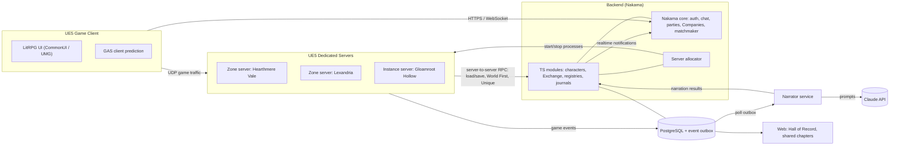

# Technical Architecture

## Goals and constraints

- **Solo/hobby team.** Use as few languages and services as possible. Prefer managed or open-source building blocks over custom infrastructure.
- **Server-authoritative.** The client never decides damage, loot, XP, or quest state.
- **Small MMO scale.** Target **200–500 concurrent players per world** at launch, with 50–100 per zone server. Scale out by adding zone and instance processes, not by building a seamless single-world server.
- **The game must run with the AI off.** The Narrator is an optional enhancement layer (see [AI Narrator](ai-narrator.md)).
- **Data-driven content.** Designers (us) tune numbers and write content in data files, not code.

## High-level components

| Component | Tech | Responsibility |
|---|---|---|
| **Game client** | Unreal Engine 5 (C++ + Blueprints) | Rendering, input, UI, GAS client prediction for cast starts/cooldown visuals |
| **Zone servers** | UE5 **dedicated server** builds, one process per zone | Authoritative simulation: movement, combat (GAS), AI, quests, loot rolls, deeds |
| **Instance servers** | Same binary, launched per dungeon/raid group | Dungeon and raid simulation |
| **Backend** | **Nakama** (open-source game backend) + **TypeScript runtime modules** | Accounts/auth, character persistence, chat, parties, Companies (guilds), matchmaking (group finder), the Exchange, World First and Unique registries, Journal storage |
| **Database** | **PostgreSQL** | Nakama storage + our tables (characters, inventories, Exchange order book, registries, event outbox, journals) |
| **Narrator service** | Node.js/TypeScript + official Anthropic SDK (`@anthropic-ai/sdk`) | Consumes game events; writes asides, NPC dialogue, Journal chapters, bounty flavor |
| **Server allocator** | Simple TypeScript service at first → **Agones** on Kubernetes later | Starts and stops zone/instance server processes, tracks capacity |
| **Web** | Static site + small API (from the backend) | Hall of Record, shared Journal chapters, account pages |

**Backend language decision:** TypeScript everywhere outside Unreal. Nakama's TypeScript runtime and the Narrator service share types (event schemas, item IDs). Performance-critical backend code can move to Nakama's Go runtime later if profiling shows it's needed.

## System diagram



## Key flows

### Login and entering the world

1. Client authenticates with **Nakama** (email/password or a platform login such as Steam) and gets a session token.
2. Client requests the character list and selects a character.
3. Backend module finds the character's zone and asks the **allocator** for a zone server with capacity, then issues a short-lived signed **join ticket** (character ID, zone, expiry).
4. Client connects to the zone server address with the ticket in the connection URL options.
5. The zone server validates the ticket signature, loads the character from the backend (server-to-server RPC), and spawns the pawn.

### Zone transfer

1. The player walks into a zone boundary volume or uses a Waystone.
2. The current zone server **saves the character** and requests a transfer ticket for the target zone.
3. The client travels to the new server (`ClientTravel`) with a loading screen styled as "turning the page."
4. The new zone server loads the character. The old server despawns it once it's confirmed.

Zones are separate maps and separate processes. There is **no seamless open world**; boundaries are hidden behind terrain (mountain passes, bridges, gates). This is the biggest architectural simplification in the plan.

### Dungeon instances

1. The group finder (Nakama matchmaker) or a party leader at the entrance requests an instance.
2. The allocator starts an **instance server** with the dungeon map and gives it the party roster.
3. Party members receive tickets and transfer as above. The instance shuts down 5 minutes after it empties or when the lockout ends.

### Persistence

- **Authoritative state lives in the zone server while you're online.** It is saved to the backend on zone transfer, on logout, every 60 seconds, and immediately after high-value events (Unique awarded, Epic+ loot, level-up, Exchange transactions).
- **Character document:** stats, attribute allocation, Proficiency per skill, deeds (counter map), inventory, equipment, quest log, titles, reputation. Stored as Postgres rows/JSONB through backend modules and versioned so saves can be migrated.
- **Idempotent saves:** each save carries a monotonic sequence number, so stale saves from a crashed server are rejected.

### Global registries (World Firsts and Uniques)

World Firsts and Unique items must be **globally unique** across all zone and instance servers:

- The zone server calls `claimWorldFirst(feat_id, character_id)` or `reserveUnique(item_id, character_id)` on the backend.
- The backend performs a **single atomic insert** (unique constraint on `feat_id` / the Unique's active holder). Exactly one caller wins.
- The winner gets the title or item. The backend broadcasts the announcement to all online players through Nakama realtime notifications, and writes a Hall of Record row.

### Event pipeline (game → Narrator)

- Zone servers emit **structured game events** such as `level_up`, `boss_killed`, `player_died`, `quest_completed`, `hidden_quest_found`, `unique_awarded`, and `rare_killed`. Each has a typed JSON schema shared between Unreal (C++ structs) and TypeScript (generated types).
- Events go into a **Postgres outbox table** (batched inserts from the backend RPC). The Narrator polls the outbox. That's one less service to run than Redis or NATS, and it's plenty for our volume. Move to Redis Streams or NATS only if measurements demand it.
- The Narrator's outputs (aside lines, chapters) are written back through backend modules and pushed to clients as Nakama notifications.

## Gameplay implementation (Unreal)

| Area | Approach |
|---|---|
| **Abilities, effects, attributes** | **Gameplay Ability System**: one `AttributeSet` for primary/secondary stats, abilities as `GameplayAbility` subclasses configured by data, `GameplayEffect`s for buffs/DoTs/HoTs, `GameplayTags` for states (Stunned, Annotated, Ignited, Blotted) |
| **Tab-targeting** | Custom targeting component: server-validated target selection, range and line-of-sight checks on the server |
| **Proficiency and Evolutions** | Proficiency stored per ability tag. Evolutions swap the granted ability class or apply a permanent modifier effect |
| **Deeds** | Server-side subsystem listening to GAS and gameplay events, incrementing counters, and checking thresholds from a DataTable |
| **AI** | StateTree (or Behavior Trees) + EQS; threat tables as a component on enemies |
| **Content data** | DataTables and DataAssets imported from CSV/JSON in `/content` (abilities, items, loot tables, quests, deeds, titles, Paths) |
| **UI** | **CommonUI + UMG**; a notification subsystem with a priority queue; the vellum visual style as a material/shader set |
| **Input** | Enhanced Input (keybinds, action bars, controller support later) |
| **Replication** | Evaluate **Iris** in the P0 spike, and fall back to Replication Graph if it isn't ready. Tune relevancy and update frequency for about 100 players per zone |

## Authority and security

- **Never trust the client** for damage, cooldowns, loot, positions of other entities, or quest state.
- Movement uses UE's server-authoritative `CharacterMovementComponent` with server corrections, plus speed/teleport sanity checks.
- Ability activations are validated on the server: cooldown, resource, range, line of sight, facing, GCD.
- **Rate limits** on RPCs (chat, Exchange, interactions) at both the zone server and the backend.
- Join tickets are short-lived and signed. Zone servers authenticate to the backend with a server key that is never shipped to clients.
- **Bot detection (Phase 5):** heuristics on gathering paths, session length, and inhuman input timing, flagged for review, not auto-banned.

## Moderation

- Chat: an optional profanity filter per player, report/mute/ignore, and GM tools (kick, mute, suspend) exposed via Nakama console + custom admin RPCs.
- **AI content:** NPC chats are private to the player, Journal chapters are private unless shared, and player text sent to the AI goes through a moderation check first. See [AI Narrator: safety](ai-narrator.md#safety-and-moderation).
- Reported shared chapters can be unpublished by GMs.

## Observability

- **Metrics:** Prometheus + Grafana (Nakama exposes metrics; zone servers export tick time, player count, and replication bandwidth through a small exporter).
- **Logs:** structured JSON logs to Loki (or plain files at first).
- **Crashes:** the UE crash reporter feeding a self-hosted endpoint or Sentry.
- **Game analytics:** from the event outbox (level curves, quest drop-off, deaths per boss, economy flows).

## Deployment

| Stage | Setup |
|---|---|
| **P0–P2** | One Linux VPS or dedicated box running **Docker Compose**: Nakama, Postgres, Narrator, allocator, and a few zone server processes |
| **P3–P4** | Two or three boxes: one for backend + DB, the rest for zone/instance servers. Nightly DB backups, off-site |
| **P5+** | Kubernetes + **Agones** for game server fleets, managed Postgres, a CDN for patches and the web |

One region at launch (chosen for the target community). A second region only if demand appears.

## Alternative considered: SpacetimeDB

**SpacetimeDB** (used by *BitCraft*) merges the database and server logic, and it's attractive for MMOs. We keep **UE dedicated servers + Nakama** as the primary plan because GAS, UE networking, and the dedicated server workflow are proven for WoW-style combat, and Nakama covers the social layer out of the box. A **Phase 0 spike** checks SpacetimeDB's Unreal support. If it's clearly simpler for a solo dev, revisit this doc before P1.

## Future repository layout

```
/docs                   design & planning docs (this folder)
/content                source-of-truth game data (CSV/JSON): abilities, items, quests, deeds, titles, Paths, loot
/content/lore           lore bible + Chronicle style guide (also used as AI prompt material)
/game                   Unreal Engine 5 project (Git LFS for binary assets)
/backend                Nakama TypeScript runtime modules, migrations, docker-compose
/services/narrator      AI Narrator service (TypeScript)
/services/allocator     Game server allocator (TypeScript), later replaced by Agones
/tools                  data import/export scripts, balance spreadsheets, admin CLIs
/web                    Hall of Record + shared Journal pages
```
